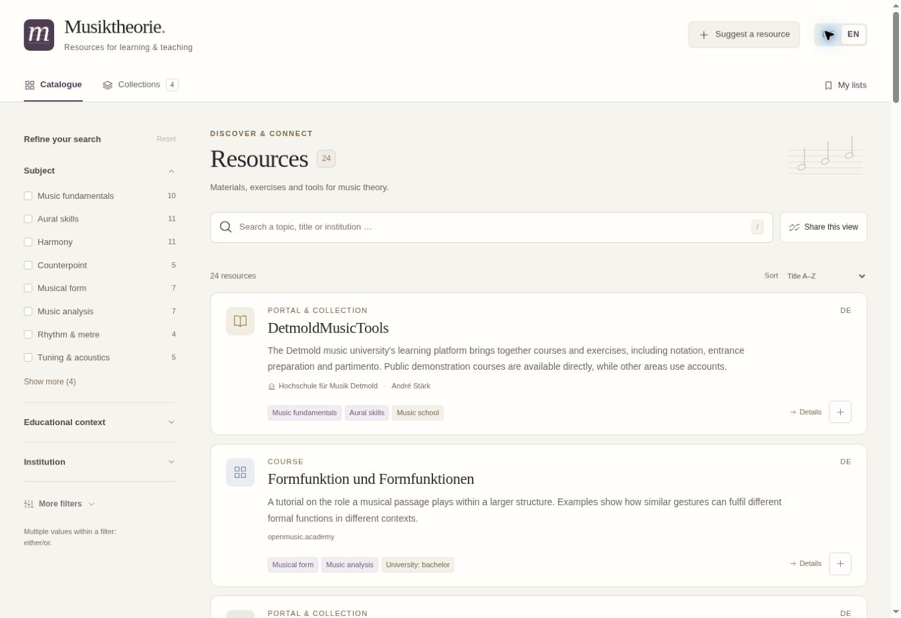

# Musiktheorie

Ein zweisprachiger Katalog für Ressourcen zu Musiktheorie und Gehörbildung. Filtern nach Fach, Bildungsbereich, Institution, Betreuung, Sprache und Format; eigene Auswahlen zusammenstellen und mit einem Link teilen.

A bilingual catalogue of music-theory and aural-skills resources, with shareable searches, ordered selections and curated teaching collections.

**Live-Katalog / Live catalogue:** <https://muk-labs.github.io/Musiktheorie/>



## What is included

- German and English interface, with sensible fallbacks for missing translations.
- Independent subject, context, difficulty, institution, maintainer, resource-language, format and access filters.
- Search across both languages, institution names and vocabulary aliases.
- URL-based state for searches, individual records, curated collections and hand-picked selections.
- Local saved selections, ordered sharing and printable catalogue views.
- A small researched starter catalogue. Resource classifications are editorial suggestions; sources and attribution are documented in [catalogue-sources.md](docs/catalogue-sources.md).
- A Google Forms / Sheets integration for public suggestions and trusted contributions **without Google sign-in**.

The public form is intentionally unconfigured until its Google owner completes setup and checks signed-out access. No submissions are silently discarded or falsely reported as sent.

## Start locally

Requires Node.js 22 or later. No application dependencies or install step are needed.

```sh
npm test
npm run build
npm run dev
```

Open <http://127.0.0.1:4173/Musiktheorie/>. To serve the exact deployment artifact instead, use `SERVE_DIR=dist npm run dev`.

## Hosting and publication

The repository uses **GitHub Actions** for Pages publication. Each update runs through the tests and public-data validation before deployment. When setting up another copy or restoring the hosting configuration:

1. Open [repository Settings → Pages](https://github.com/MUK-Labs/Musiktheorie/settings/pages).
2. Under **Build and deployment → Source**, choose **GitHub Actions**.
3. Open [Check and publish catalogue](https://github.com/MUK-Labs/Musiktheorie/actions/workflows/pages.yml) and choose **Run workflow**.

The workflow tests and validates the data before publication. If Pages is not enabled yet, it still builds an artifact and explains the remaining setup in its summary. Every subsequent accepted update to `main` publishes automatically. There is no polling dependency or scheduled workflow to maintain.

## Google setup and editorial handover

Follow [Google setup](docs/google-setup.md) for the one-time administrator setup. The installable Apps Script creates the form and private editorial workbook and provides invitation management and publication controls. Google authorization and a repository-scoped publication credential belong to the project owner, not to contributors.

The contribution rules are:

| Contributor | Route | Publication |
|---|---|---|
| Public visitor | Public form, no code | An editor reviews the suggestion |
| Trusted colleague | The same form through a personal invitation link | A valid active code publishes automatically; no human approval |
| Catalogue editor | Private Google Sheet | Edit, approve, archive and manage collections in Sheets |

Contributors do not need a Google account. Administrators use their own Google accounts to manage the workbook and automation. Invitation links are bearer credentials: anyone holding a link can use it; individual invitations can be revoked.

Read the [editor guide](docs/editor-guide.md) for day-to-day work. Never put invitation codes, hashes, submitter contact details or repository credentials into `config.json` or the public catalogue.

## Data and publication

Before Google setup, `data/catalogue.json` contains the researched starter catalogue. After setup, **Google Sheets is the editorial source**, and this repository receives approved public snapshots. Make routine catalogue edits in Sheets to avoid the next export overwriting a manual snapshot edit.

- [Public data contract](docs/data-contract.md)
- [Editorial and technical decisions](docs/architecture.md)
- Public configuration: `config.json` (the general responder URL only)
- Public snapshot: `data/catalogue.json`
- Google implementation: `google-apps-script/`

The website build copies only the public application and its validated data into `dist/`. The Google integration exports explicitly permitted fields. Private submissions and invitations stay out of the site.

## Shared links

```text
?ui=de&subject=harmony&stage=pre-university
?ui=en&language=de&institution=mdw
?ui=de&items=r-one,r-two,r-three&title=Meine+Auswahl
?ui=en&collection=c-example
```

IDs in these examples illustrate the format. Copy links from the working catalogue to use actual records. Multiple values within a filter mean OR; different filters combine with AND. Search links show current matching records. Selection links preserve membership and order, while record descriptions and destinations may be corrected later.

## Credits

Konzept und Projektleitung: **Adrián Artacho**. Repository: **MUK-Labs**.

Linked resources retain their authorship and licensing. Descriptions and suitability labels in this catalogue are editorial metadata, not claims of endorsement by the referenced institutions.
